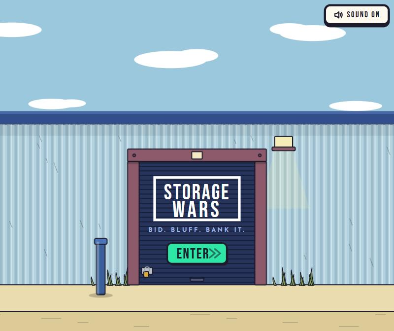
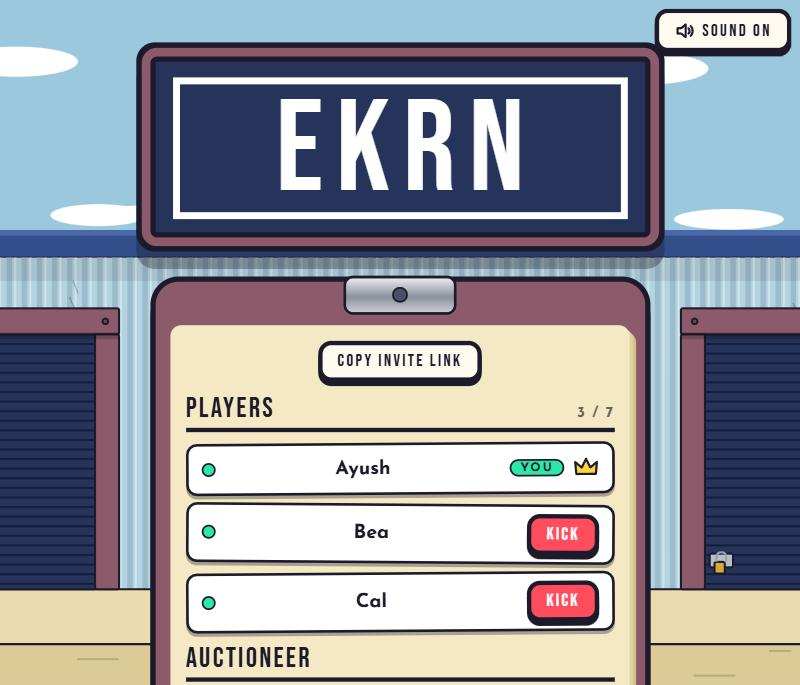
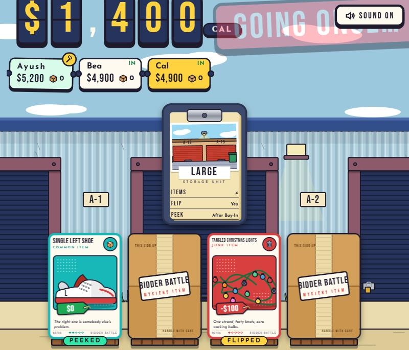
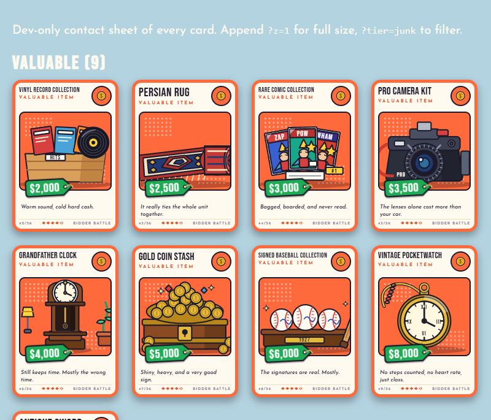

# STORAGE WARS

Bid on mystery storage units with your friends, in real time, right in the browser. Peek, bluff, and try not to win a unit full of mold.

STORAGE WARS is a free online version of the storage-unit auction card game *Bidder Battle*, for 3 to 7 players. Share a room code, everyone joins from their phone or laptop, and the auction starts.



## How a game works

Everyone starts with the same cash ($5,000 by default). The game has an **automatic Auctioneer**: it puts one **storage unit** at a time up for auction, and every player can bid on every unit.

- **Buy in** (by default $100, paid to the bank) to join the auction, or pass. Everyone decides at the same time.
- **Peek** at a crate, or watch the Auctioneer flip one, depending on how big the unit is. Peeks are private: only you see what you peeked at.
- **Bid** in steps of $100, up to what you can pay (cash plus the value of your items). When the bidding stops, the Auctioneer calls "going once, going twice, SOLD!" by itself.
- The winner **pays the bank** with cash or items they already won, and opens the unit. Junk costs you money, valuables pay off, and a **Havoc** card wipes out the whole unit, so you paid for nothing.
- After the last round the richest player (cash plus item values) wins.

The host sets the game up in the lobby: the number of rounds (1 to 99; the decks reshuffle when they run out), starting cash ($1,000 to $20,000) and the buy-in fee ($100 to $1,000). A **How to play** booklet with pictures of the real cards and controls is on the entry screen.





## The cards

56 item cards (junk, common, valuable, unique and Havoc) and 16 storage units, every one hand-drawn as vector art. Values are tuned in one file and balance-tested with a bot simulation.



## Features

- Realtime play over WebSockets, with a 4-letter room code and an invite link
- Hidden information is enforced on the server: your browser never receives a card you are not allowed to see
- An automatic Auctioneer, timers for every waiting phase, and rejoin after a dropped connection
- Works on phones and laptops, with synthesized sound effects and a mute switch
- No accounts, no database: rooms live in memory

## Run it locally

Needs Node 20 or newer.

```bash
npm install
npm start        # http://localhost:3000
npm test         # rules engine, rooms, realtime, UI markup and art checks
```

## Put it online for free

See [DEPLOY.md](DEPLOY.md). It covers a free Render web service and a no-account option that runs from your own computer.

## Project layout

| Path | What |
|---|---|
| `shared/cards.js` | The 56 items and 16 storage units (edit values here) |
| `server/game/` | The rules engine: pure functions, fully tested |
| `server/rooms.js`, `server/index.js` | Rooms, lobby and the Socket.IO server |
| `client/` | The browser game: plain ES modules, SVG art, synthesized sound |
| `client/dev/art-sheet.html` | Contact sheet of every card (open it while the server runs) |
| `tools/dev-bots.js` | Dev only: joins a room as scripted guests so one person can test alone |
| `tools/balance-sim/sim.py` | The simulation used to balance the deck |
| `docs/qa-checklist.md` | What was checked by hand before release |

## Credits

An unofficial fan project inspired by the tabletop game *Bidder Battle* by Running Innovation. All artwork, code and card text here are original.
